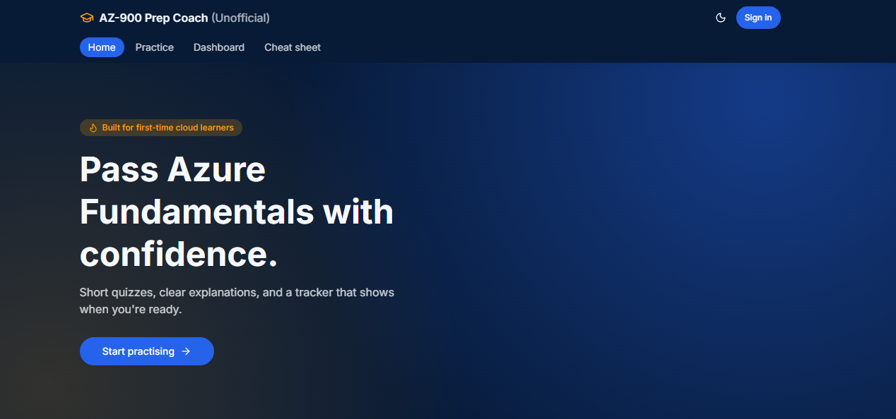
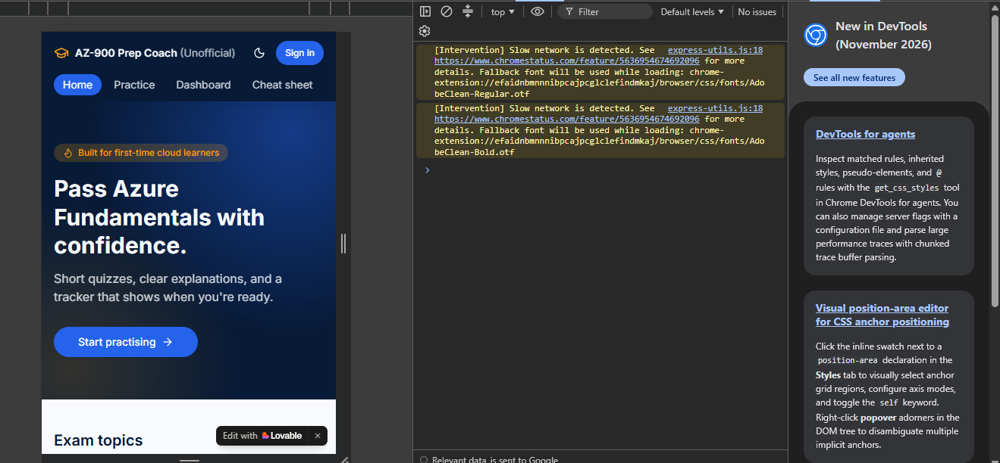
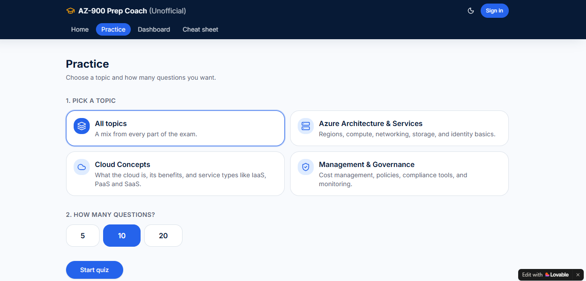
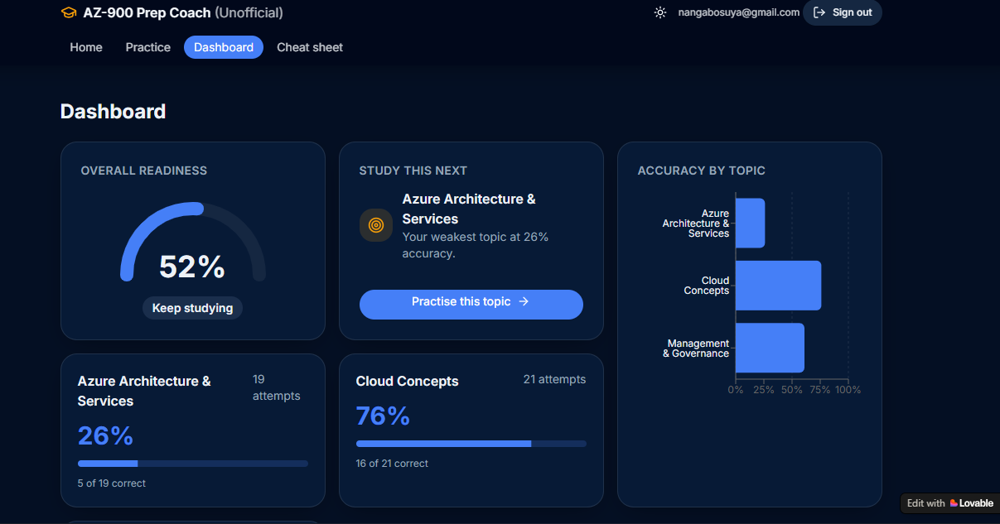
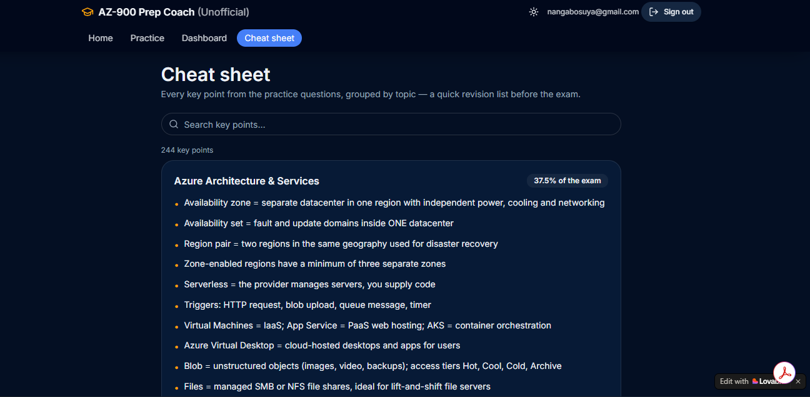

# AZ-900 Prep Coach (Unofficial)

Scenario based practice, a searchable cheat sheet and a readiness tracker for the Microsoft Azure Fundamentals (AZ-900) exam.

This is an unofficial community study tool. It is not affiliated with, endorsed by or sponsored by Microsoft. All questions are original and were written for this project from the public AZ-900 skills outline on Microsoft Learn. No real exam questions and no Microsoft logos are used. Microsoft and Azure are trademarks of the Microsoft group of companies.

## Project Links

- Live application: https://azure-ready-quest.lovable.app
- Demo video: https://youtu.be/XJJtN91rgnM
- Source code: https://github.com/SuyaNangabo/cloudready-coach
- AI prompts: the prompts folder in this repository

This project was built for the #1MillionDevs Vibe Coding Hackathon: AZ-900 Exam Prep Edition, held from 20 to 23 October 2026. The main track is Practice and Assessment (Smart Quiz Builder), with a Readiness Tracker built on top of it.

## Contents

1. Overview
2. The Problem
3. The Solution
4. How It Works for the Learner
5. Features
6. Screenshots
7. The Question Bank
8. How the Readiness Score Works
9. Architecture
10. Data Model
11. Tech Stack
12. Project Structure
13. Security and Privacy
14. Testing and Quality
15. Run It Locally
16. How AI Was Used
17. Development Journey
18. Judging Criteria
19. Responsible Use
20. Known Limitations
21. Roadmap
22. Acknowledgements
23. Author

## Overview

AZ-900 Prep Coach is a web application that helps beginners prepare for the Azure Fundamentals exam. A learner signs in, practises by topic or across all topics, receives an explanation for every answer straight away, revises from a searchable cheat sheet, and uses a dashboard to see how ready they are and what to study next.

The project was built in four days as a hackathon prototype. It focuses on three goals: learning value (accurate, explanatory, scenario based content), a clean and simple experience, and clean, documented code.

## The Problem

When I practised for AZ-900 with the Microsoft practice questions, I found that most of them asked for a specific Azure service or a definition of a term. That tests recall, but it does not build the skill the exam rewards, which is reading a real life situation and choosing the right service, model or feature. When I answered a question wrongly, the explanation did not always help me understand why.

I also found it hard to check a single keyword quickly. If I wanted to confirm the difference between two terms, I had to scroll through notes or search several sources.

Finally, I had no sense of readiness. I could not tell whether my scores were good enough to sit the exam, or which topic was holding me back. These are the same problems the hackathon brief describes: learners who do not understand why an answer is right or wrong, and who do not know whether they are ready to sit the exam.

## The Solution

AZ-900 Prep Coach addresses each of these problems directly.

- Questions that only test terms are replaced with 60 original scenario based questions. Each one describes a real business situation and asks what the learner should do.
- Thin explanations are replaced with instant feedback. The app explains why the right answer is right, why every other option is wrong, and lists key points to remember.
- The lack of a quick lookup is solved by a cheat sheet of 244 key points, grouped by topic, with a search box.
- The lack of a readiness signal is solved by a dashboard that shows accuracy for each topic, an overall readiness score, and a suggestion for what to study next.

## How It Works for the Learner

1. Sign up or sign in with an email address and a password of at least 8 characters.
2. Choose one topic or all topics, and choose 5, 10 or 20 questions.
3. Read a scenario question and choose an answer.
4. See the feedback straight away: the correct option, the reason for every option, and key points.
5. Answer five questions correctly in a row to trigger a celebration animation and a streak badge.
6. Finish the quiz to see your score, review each question, and retry the ones you got wrong.
7. Use the cheat sheet and its search box to look up any keyword in seconds.
8. Open the dashboard to see your accuracy by topic, your overall readiness and the topic to study next.

## Features

### Practice

Learners can choose All topics or one of the three AZ-900 skill areas: Cloud Concepts, Azure Architecture and Services, and Management and Governance. They can choose to answer 5, 10 or 20 questions. Questions are shuffled, so each session is different.

### Scenario Based Questions and Feedback

Every question describes a realistic situation, such as a bank with data residency rules or a start up that wants to pay only for what it uses. Each question has four plausible options, so the learner has to reason about the situation instead of recognising a keyword.

After answering, the learner sees whether they were right, a plain language explanation, the reason each option is right or wrong, and a short list of key points.

### Streak Celebration

Five correct answers in a row trigger a celebration animation and a streak badge. This keeps practice motivating.

### Results and Retry

At the end of a quiz the learner sees a score summary and can review each question. The learner can start a new round with only the questions they answered wrongly.

### Cheat Sheet With Search

The cheat sheet collects 244 key points from the question bank and groups them by topic. Each topic shows its share of the exam. A search box filters the key points as the learner types, so any keyword can be checked in seconds.

### Readiness Dashboard

The dashboard shows an overall readiness gauge with a label, accuracy by topic as cards and as a bar chart, and a Study this next card that points to the weakest topic and starts a quiz on it.

### Accounts and Personal Progress

Learners sign up and sign in with an email address and a password. Answers are saved to the learner's own account, so the dashboard reflects only their own progress.

### Design

The layout is designed for phones first and also works on tablets and laptops. It has a light and a dark mode, and every page has clear loading, empty and error states.

## Screenshots

Home page on a laptop



Home page on a phone sized screen



Choosing a topic and the number of questions



Instant feedback after answering a question


Readiness dashboard



Cheat sheet with search



## The Question Bank

The app contains 60 original questions.

- Cloud Concepts has 16 questions. They cover the shared responsibility model, capital and operational expenditure, scaling and elasticity, reliability and predictability, IaaS, PaaS and SaaS, serverless computing, hybrid and multi cloud, and governance.
- Azure Architecture and Services has 23 questions. They cover regions, availability zones and region pairs, compute services, storage and redundancy, networking such as ExpressRoute, VPN, peering, network security groups and private endpoints, identity with Microsoft Entra ID, Conditional Access and multifactor authentication, Zero Trust, Cosmos DB and data migration.
- Management and Governance has 21 questions. They cover Azure Policy, resource locks, role based access control and management groups, tags, cost management and pricing tools, service level agreements, support plans, Microsoft Purview, Azure Monitor, Service Health, Azure Advisor, Cloud Shell, ARM templates and Bicep, and Azure Arc.

Each question has a scenario, four options, the correct answer, an explanation a beginner can follow, a reason for every option, three to five key points that feed the cheat sheet, and a difficulty level of easy, medium or hard.

### Example Question

Contoso runs a payment API in a single Azure region. The API must stay available if one entire datacenter in that region loses power, and the application tiers must keep very low latency between them. What should Contoso do?

A. Place the virtual machines in an availability set within one datacenter.
B. Deploy the virtual machines across availability zones in the region.
C. Deploy a standby copy in the paired region and fail over to it.
D. Use a single virtual machine with premium SSD disks.

The correct answer is B. Availability zones are physically separate datacenters inside a region, each with independent power, cooling and networking, joined by low latency links.

Option A is wrong because an availability set only spreads machines across racks inside one datacenter, so a datacenter wide failure can still take them all down. Option C is wrong because a paired region is a disaster recovery choice across regions, with higher latency. Option D is wrong because a single machine in a single datacenter is still a single point of failure.

Key points from this question: an availability zone is a separate datacenter in one region, an availability set is fault and update domains inside one datacenter, and a region pair is two regions in the same geography used for disaster recovery.

### How the Questions Were Created and Checked

First, a structured prompt, saved in prompts/generate-questions.md, asked an AI model to draft scenario based questions from the public AZ-900 skills outline. Second, I checked every question against Microsoft Learn, including the correct answer, the reason each wrong option is wrong and every key point. Third, only the verified questions were added to the database.

## How the Readiness Score Works

The score is designed to be simple and easy to explain.

A topic receives an accuracy score only after the learner has answered at least 5 questions in it. This prevents one lucky or unlucky answer from creating a misleading score.

The overall readiness score is the average of the topic accuracies, weighted by each topic's share of the exam. Only topics with at least 5 answers are included. In words, multiply each topic's accuracy by its exam weight, add the results together, and divide by the total of the weights that were used.

The labels are:

- Below 60 percent: Keep studying
- 60 to 79 percent: Almost there
- 80 percent and above: Exam ready

A learner is only shown as Exam ready from 80 percent upwards.

Here is a worked example using illustrative numbers. Cloud Concepts has a weight of 27.5 and an accuracy of 76 percent. Azure Architecture and Services has a weight of 37.5 and an accuracy of 26 percent. Management and Governance has a weight of 35 and an accuracy of 62 percent. The weighted total is 2090 plus 975 plus 2170, which is 5235. Dividing by the total weight of 100 gives 52 percent, so the label is Keep studying. The Study this next card then points to Azure Architecture and Services, because it is the weakest topic.

The exam weights used are approximations based on the published skill area ranges.

## Architecture

The application has four parts that work together.

1. The web application is built with React and TanStack Start. It shows the pages and runs the quiz.
2. Supabase Auth handles sign up and sign in.
3. A Supabase Postgres database stores the topics, the questions and each learner's answers. A database view calculates each learner's results for every topic.
4. The published application is hosted on Lovable.

The web application talks to Supabase directly using the project's publishable key. Row Level Security in the database decides what each user may read and write.

The quiz, results and dashboard pages require sign in. Signed out visitors are sent to the sign in page. The home page, practice setup page and cheat sheet are public. If the question bank cannot be loaded, the quiz falls back to a small built in sample set so that the learner never sees an empty page.

## Data Model

The database has three main tables and one view.

- topics: the three exam areas, each with an identifier, a short name called a slug, a display name and an exam weight.
- questions: each question with its topic, the question text, the four options, the index of the correct option, an explanation, a reason for every option, key points and a difficulty.
- attempts: each saved answer with the user, the question, the option chosen and whether it was correct.
- topic_stats (view): counts each user's attempts and correct answers for every topic, so the dashboard needs a single query.

An explanation_cache table also exists. It was prepared for a future AI Study Buddy and is not used yet.

### Database Setup

```sql
create table topics (
  id uuid primary key default gen_random_uuid(),
  slug text unique not null,
  name text not null,
  exam_weight numeric not null
);

create table questions (
  id uuid primary key default gen_random_uuid(),
  topic_id uuid references topics(id) on delete cascade,
  question text not null,
  options jsonb not null,
  correct_index int not null,
  explanation text not null,
  option_explanations jsonb,
  key_points jsonb default '[]'::jsonb,
  difficulty text default 'medium'
);

create table attempts (
  id uuid primary key default gen_random_uuid(),
  user_id uuid not null default auth.uid() references auth.users(id) on delete cascade,
  question_id uuid references questions(id) on delete cascade,
  selected_index int not null,
  is_correct boolean not null,
  created_at timestamptz default now()
);

alter table topics enable row level security;
alter table questions enable row level security;
alter table attempts enable row level security;

create policy "anyone can read topics" on topics for select using (true);
create policy "anyone can read questions" on questions for select using (true);
create policy "users read own attempts" on attempts for select using (user_id = auth.uid());
create policy "users add own attempts" on attempts for insert with check (user_id = auth.uid());

create view topic_stats with (security_invoker = true) as
select a.user_id, q.topic_id,
       count(*) as attempts,
       count(*) filter (where a.is_correct) as correct
from attempts a join questions q on q.id = a.question_id
group by a.user_id, q.topic_id;
```

## Tech Stack

- Language: TypeScript
- Front end: React 19, TanStack Start and Router, TanStack Query
- Styling: Tailwind CSS 4 and shadcn/ui components, with lucide icons
- Charts: Recharts
- Validation and notifications: Zod and Sonner
- Back end: Supabase, which provides the Postgres database, authentication and Row Level Security
- Build tool: Vite
- Testing and code quality: Vitest, Testing Library, ESLint and Prettier
- Hosting: Lovable
- Tools used during development: Lovable, VS Code, Claude and the Supabase dashboard

## Project Structure

- prompts: the AI prompts used to draft the questions and the interface
- docs: the screenshots used in this README
- src/routes: the pages. These are the home page, the practice setup page, the cheat sheet, the sign in page, and the protected quiz, results and dashboard pages.
- src/components: reusable pieces such as the navigation bar, topic cards, the celebration animation and empty states
- src/hooks: useAuth holds the shared sign in state, and useQuiz holds the quiz state and loads the questions
- src/lib: api.ts reads data from Supabase, scoring.ts holds the accuracy and readiness calculations as small typed functions, and progress.ts holds small helpers
- src/integrations/supabase: the Supabase client and generated types
- src/data: a small fallback set of sample questions
- src/test: unit and routing tests
- .env.example: the names of the settings the app needs, without any values

## Security and Privacy

Row Level Security is switched on for every table. Anyone can read topics and questions. Each learner can only read and write their own answers.

The browser only ever uses the project's publishable key. No private or service keys are used in the front end.

Passwords are handled by Supabase Auth. The application never stores or sees them.

Protected pages send signed out visitors to the sign in page.

The only personal data stored is the learner's account email address and their own answers.

## Testing and Quality

The scoring logic is written as small, pure, typed functions and is covered by unit tests. A routing test checks that the main pages render.

Manual testing covered sign up, sign in and sign out, practising each topic and all topics together, saving answers (checked in the database, with exactly one row for every answer), the dashboard, the cheat sheet search, and a phone sized screen.

Code style is enforced with ESLint and Prettier. To run the tests:

```bash
npm test
```

## Run It Locally

You need Node.js (the LTS version), Git, and a free Supabase project that uses the database setup above.

```bash
git clone https://github.com/SuyaNangabo/cloudready-coach.git
cd cloudready-coach
npm install
```

Next, copy .env.example to .env and fill in your Supabase project URL and publishable key. You can find them in Supabase under Project Settings, then API. Create the tables by running the database setup in the Supabase SQL editor, and then add your own topics and questions.

Start the application:

```bash
npm run dev
```

Open http://localhost:8080 in your browser.

Other useful commands:

```bash
npm test
npm run lint
npm run build
```

## How AI Was Used

AI was used as a drafting and coding aid, and a person checked the results. The application itself does not call an AI model while a learner uses it.

For the question bank, Claude drafted scenario based questions from a structured prompt that returned ready to run SQL. I verified every answer, explanation and key point against Microsoft Learn.

For the interface, Lovable prompts scaffolded the home, practice, quiz, results and dashboard screens. I reviewed each screen and adjusted it.

For the sign in flow, the connection to Supabase, the dashboard hookup and debugging, Claude helped me write and fix code in VS Code. Everything was tested by hand, and saved answers were checked in the database.

The prompts are saved in the prompts folder. The file generate-questions.md contains the question writing prompt and the verification process. The file lovable-ui-prompts.md contains the interface prompts.

The question prompt was written this way for five reasons. It limits the scope to the public skills outline, which keeps the content relevant and original. It asks for SQL directly, which removes a manual conversion step. It requires a reason for every option, so the feedback teaches why wrong answers are wrong. It requires key points, which also feed the cheat sheet. And it is followed by a human verification step, so the AI drafts and a person checks.

## Development Journey

On Tuesday 20 October I planned the scope, designed the database, created the Supabase project, generated the screens with Lovable, and wrote and verified the first questions.

On Wednesday 21 October I grew the question bank to 60, connected the application to Supabase, added sign in, saved answers, and fixed a sign in state problem so that the dashboard loaded.

On Thursday 22 October I finished the dashboard and cheat sheet, published the application, wrote the prompts folder and this README, built the pitch deck and recorded the demo video.

On Friday 23 October I completed the final checks and submitted the project.

### Challenges and What I Learned

My free build credits ran out part way through, so I moved the remaining work into VS Code and finished the data connection, sign in and dashboard by hand. This taught me how the pieces connect instead of leaving them as a black box.

A sign in state problem left some pages on a loading screen and the navigation bar on Sign in. Replacing the sign in check with one shared store fixed it for every page.

Content written with AI needs checking. Verifying each question against the source material was the most important quality step, and also the slowest.

Small design decisions matter. For example, a topic needs 5 answers before it shows a score, so that a single answer cannot give a misleading result.

## Judging Criteria

Learning Value: The project has 60 original scenario based questions, a reason for every option, key points, a searchable cheat sheet and a readiness tracker. Content was verified against Microsoft Learn.

Prompt Engineering: The prompts are structured, limited in scope and saved in the prompts folder, and they are followed by a human verification step.

User Experience: The interface is clean, designed for phones first, available in light and dark mode, and has loading and empty states and a streak celebration.

Rapid Prototyping and Execution: A published application with accounts, real data, scoring and a dashboard was built in four days.

Technical Creativity: The project includes a weighted readiness score, a database view for per topic statistics, Row Level Security, and a cheat sheet generated from the question data itself.

Presentation and Documentation: This README, a live demo, a demo video, the saved prompts and a pitch deck.

## Responsible Use

This is an unofficial study aid. It is not affiliated with or endorsed by Microsoft, and it does not guarantee a pass in the exam.

No real exam questions are used or reproduced. All questions were written for this project, and no Microsoft logos appear in the application.

Always check the current AZ-900 skills outline on Microsoft Learn for what the exam covers, because it changes over time: https://learn.microsoft.com/credentials/certifications/azure-fundamentals/

## Known Limitations

This is a prototype built in four days. The question bank has 60 questions for now. The exam weights used for scoring are approximations of the published ranges. A topic needs 5 answered questions before it shows a score, and answers are saved only for signed in users. The database setup is described in this README but is not yet provided as a ready to run migration file.

## Roadmap

These features are not built yet.

- An AI Study Buddy that explains concepts in simple terms, with African examples and in Swahili
- Flashcards generated from missed questions
- A personal study planner based on exam date, available time and weak areas
- A larger question bank with community review
- Other certifications, by swapping the question bank
- A ready to run database migration file

## Acknowledgements

Thank you to the #1MillionDevs community and the hackathon organisers, to Microsoft Learn, whose public skills outline defines the scope, and to Supabase, Lovable and Claude, the tools that helped build this project.

## Author

Name: Brenda Suya Nangabo
GitHub: https://github.com/SuyaNangabo
LinkedIn: linkedin.com/in/brenda-suya-nangabo-8b804a377
